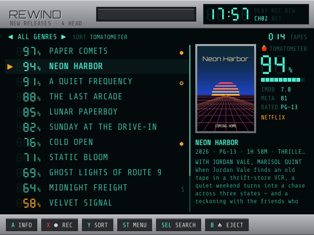
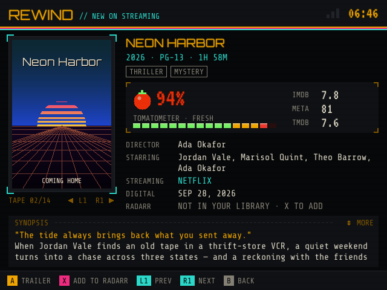
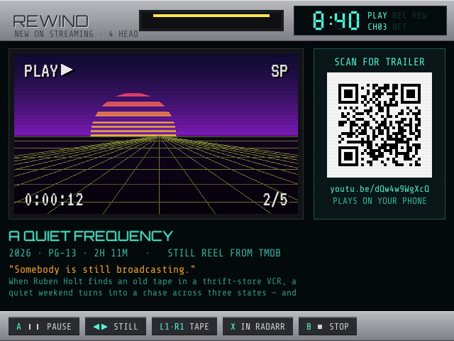
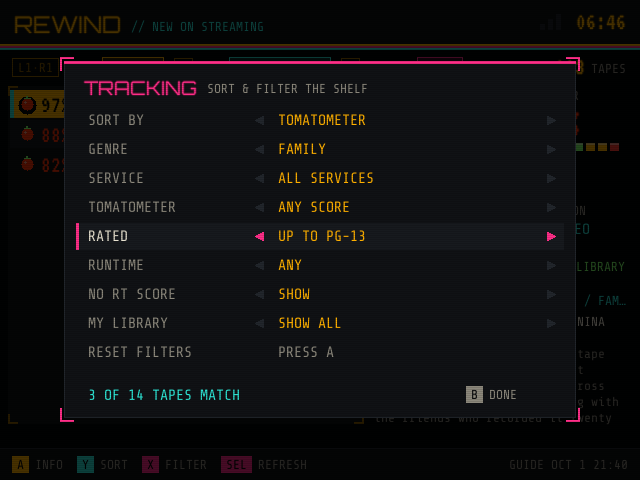
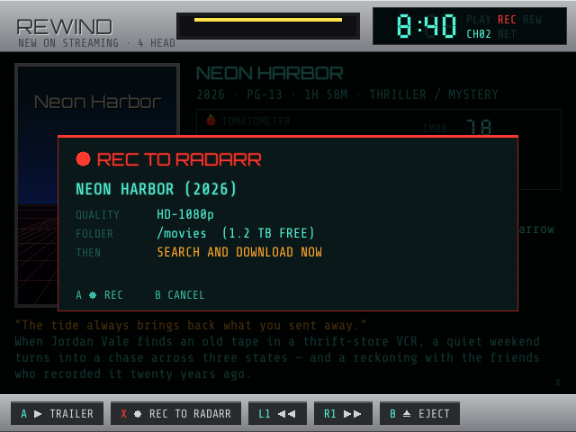
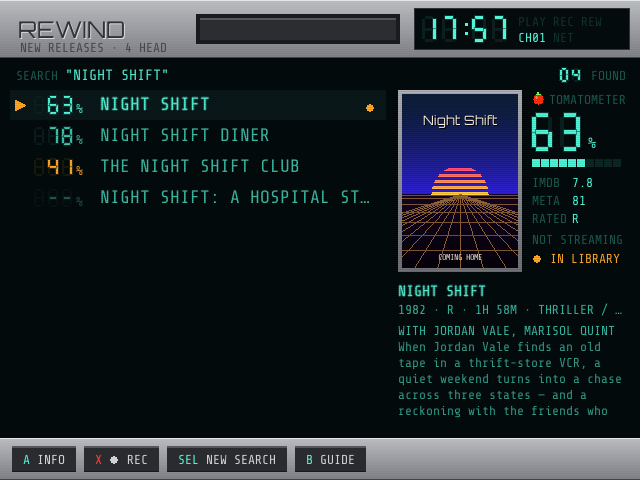

# REWIND

**New releases, for OnionOS on the Miyoo Mini Plus.** Rewind is a pocket video-store shelf: it lists movies that recently came out digitally in your country, whether they're on a streaming service or only to rent or buy, with their Rotten Tomatoes Tomatometer, IMDb rating, Metascore, age rating, runtime, cast and services. Sort and filter the shelf, and scan a QR code to watch any trailer on your phone.

> 🤖 **Built by Claude.** Rewind was designed and written by [Claude](https://claude.ai), Anthropic's AI model, at the request of [@snyderman3000](https://github.com/snyderman3000). He came up with the idea and chose the direction. Claude wrote the code, the documentation and the artwork. It shares its rendering engine with [Mixtape](https://github.com/snyderman3000/mixtape). Please report bugs through [Issues](https://github.com/snyderman3000/rewind/issues).

| | |
|---|---|
|  |  |
|  |  |
|  |  |

*Screenshots use invented movies, scores and artwork.*

## Features

- **What's new.** Films whose digital release was in the last 120 days (configurable), whether Netflix, Prime Video, Disney+, Max, Hulu or another subscription service carries them or they're only to rent or buy (Apple TV, Amazon, Google Play and so on). Rentals are marked **$** on the shelf, and the **WATCH ON** filter shows streaming only, rentals only, or both.
- **Scores.** Rotten Tomatoes Tomatometer (on an LED meter, of course), IMDb rating, Metascore and TMDB rating.
- **The details.** Age rating, runtime, genres, director, writers, cast with roles, tagline, synopsis, digital release date and every service it's on.
- **Search any movie.** Press **SELECT** and type a title on the on-screen keyboard to find any film, however old, with its scores, details and services. Press **X** on a result to record it to Radarr. Your last five searches are one press away.
- **Sort** by Tomatometer, newest, popular, IMDb, Metascore, title or runtime.
- **Filter** by genre, service or store, streaming vs. rental, minimum Tomatometer (60 / 75 / 90%), age rating (G, up to PG, up to PG-13, R only), runtime, and hide unscored films. Choices are remembered.
- **Trailers.** The Miyoo can't play YouTube, so each film gets a VCR-style reel of its stills, with a QR code beside it that opens the real trailer on your phone.
- **Radarr button.** Point Rewind at your Radarr and press **X** on any movie (on the shelf, its details or its trailer) to add it. Radarr searches and downloads it, and it lands in Plex (or whatever watches that folder). The shelf marks what you already have, the details screen shows download progress, and a filter hides (or shows only) what's in your library.
- **Fast and offline-friendly.** The guide is cached on the SD card, opens instantly, and refreshes itself in the background every few hours.
- **VCR front-panel look.** The screen sits inside a silver VCR deck: glowing vacuum-fluorescent clock and indicators, seven-segment scores, deck keys, a VHS tape that rewinds while the guide loads, plus VCR on-screen display, tracking noise and a blue-screen sign-off.

## Install

1. Download `Rewind-vX.Y.Z-OnionOS.zip` from [Releases](https://github.com/snyderman3000/rewind/releases).
2. Extract it and copy the `App` folder to the root of your SD card, merging it with the `App` folder already there.
3. Get two free API keys:
   - **TMDB** (required): [themoviedb.org/settings/api](https://www.themoviedb.org/settings/api). Either the v3 API key or the v4 API Read Access Token works.
   - **OMDb** (for Rotten Tomatoes, IMDb and Metacritic scores): [omdbapi.com/apikey.aspx](https://www.omdbapi.com/apikey.aspx). The free tier allows 1,000 lookups a day, which is plenty because Rewind caches scores.
4. Copy `App/Rewind/config.example.json` to `App/Rewind/data/config.json` and paste in the keys. If you open Rewind first instead, it creates that file for you and shows QR codes for both sign-up pages.
5. Turn Wi-Fi on and open **Apps → Rewind**. The first load takes about a minute.

Requires OnionOS 4.2 or newer and Wi-Fi (Miyoo Mini Plus or Mini Flip).

## Controls

| Screen | Buttons |
|---|---|
| Shelf | ↑↓ move · ←→ page · **A** details · **X** add to Radarr · **L1/R1** genre · **L2/R2** service · **Y** sort · **START** menu (filters, refresh) · **SELECT** search · **B** exit |
| Search keyboard | ↑↓←→ move · **A** type · **B** delete · **X** space · **Y** clear · **START** search · **SELECT** cancel |
| Search results | ↑↓ move · **A** details · **X** add to Radarr · **SELECT** new search · **B** back to the guide |
| Details | **A** trailer · **X** add to Radarr · **Y** recheck Radarr · ↑↓ scroll synopsis · **L1/R1** previous/next · **B** back |
| Trailer | **A** pause/play · ←→ still · **L1/R1** previous/next · **X** add to Radarr · **B** back |

MENU exits from anywhere.

## Settings

`App/Rewind/data/config.json`:

| Key | Default | Meaning |
|---|---|---|
| `tmdb_api_key` | | TMDB v3 key or v4 read access token |
| `omdb_api_key` | | OMDb key |
| `region` | `US` | Country for services and age ratings |
| `language` | `en-US` | Language for titles and synopses |
| `days` | `120` | How recent a release must be (digital, theatrical or premiere) |
| `max_movies` | `250` | How many films to keep (up to 400; more means a longer first load) |
| `providers` | `[]` | Only these services, by TMDB id: 8 Netflix, 9 Prime Video, 337 Disney+, 15 Hulu, 1899 Max, 531 Paramount+, 386 Peacock, 350 Apple TV+ |
| `refresh_hours` | `6` | How old the guide can get before it refreshes on launch |

### Radarr (optional)

| Key | Default | Meaning |
|---|---|---|
| `radarr_url` | | Radarr's address on your network, e.g. `http://192.168.1.20:7878` (include a URL base such as `/radarr` if you set one) |
| `radarr_api_key` | | Radarr → Settings → General → API Key |
| `radarr_quality_profile` | first profile | Profile name or id, e.g. `HD-1080p` |
| `radarr_root_folder` | first root folder | e.g. `/movies` |
| `radarr_search` | `true` | Search for the movie as soon as it's added |
| `radarr_minimum_availability` | `released` | `announced`, `inCinemas` or `released` |

The shelf marks movies already in Radarr: **●** downloaded, **○** added but not downloaded yet. The handheld talks to Radarr directly, so it has to be on the same network. To have new downloads appear in Plex right away, add Plex under Radarr's Settings → Connect.

Logs are written to `App/Rewind/data/rewind.log`.

## How "new" works

Rewind lists films whose **first US home release** was in the last `days` days (120 by default) and that you can watch at home now: on a subscription, free or ad-supported service, or to rent. "Where to watch" comes from JustWatch via TMDB.

**NEWEST** sorts by the day a film first came home:

- its **first** US digital release on TMDB. Later digital entries (4K editions, re-releases) and theatrical re-releases don't count, and dates that haven't happened yet are ignored, so a film whose digital release is still to come isn't listed, even when pre-orders are open;
- or, when TMDB has no digital date yet (volunteers enter it, often days late), the day Rewind first saw the film available to rent or stream. Its details show **IN THEATERS** and **AT HOME BY** dates. Films that are only for sale are left out until TMDB has a date, because that's usually a pre-order.

Films first released more than two years ago are never listed, whatever re-release dates TMDB has. Older films that only now reach Netflix or Max aren't listed either: use **SELECT** to search for those.

Rewind finds candidates in passes, most popular first, so no group crowds out another: digital releases of the last two weeks, films in US theaters in the window, films that premiered anywhere in the window, digital releases of the window, and streaming releases of the window. It reads each candidate's details and keeps those that qualify; ones that never will (older films) aren't re-read for a week. `rewind.log` lists how many were left out and why, and the newest five each refresh.

Scores come from OMDb, looked up by IMDb id.

## How it works

| File | Purpose |
|---|---|
| `device.go` | Framebuffer output (rotated 180° for the Mini's panel) and button input, shared with Mixtape |
| `gfx.go`, `gfx_vhs.go`, `gfx_deck.go` | Software renderer: fonts, VHS tape, deck panels, seven-segment digits, tomato badges, QR codes, VCR effects |
| `ui.go`, `ui_draw.go` | Navigation, and drawing each screen |
| `ui_search.go` | On-screen keyboard and the search results shelf |
| `tmdb.go` | Discover, search, details, genres, trailer and still selection |
| `omdb.go` | Tomatometer, IMDb and Metascore |
| `library.go` | Cached guide, background refresh, filtering and sorting |
| `radarr.go`, `ui_radarr.go` | Radarr v3 API: library markers, download progress, adding movies |
| `images.go` | Poster and still downloads, scaled and cached on the card |

It compiles to a single static ARMv7 Go binary, with no SDL or C toolchain involved.

## Building

Requires Go 1.24 or newer.

```sh
./build.sh               # runs the tests, then builds dist/Rewind-vX.Y.Z-OnionOS.zip
go run . -shot detail    # renders a demo screen to shot.png (boot|list|filter|detail|trailer|keyboard|search|setup|bye)
```

## Credits and data

- **Movie data and images:** [TMDB](https://www.themoviedb.org). This product uses the TMDB API but is not endorsed or certified by TMDB.
- **Streaming availability:** [JustWatch](https://www.justwatch.com), via TMDB.
- **Scores:** [OMDb API](https://www.omdbapi.com). Rewind isn't affiliated with Rotten Tomatoes, IMDb or Metacritic.
- **Fonts:** Share Tech Mono, VT323 and Orbitron (SIL Open Font License).
- **QR encoder:** adapted from [rsc.io/qr](https://github.com/rsc/qr) (BSD-3-Clause).
- **CA certificates:** Mozilla bundle via curl (MPL 2.0).

MIT licensed. See [LICENSE](LICENSE) and [THIRD_PARTY_NOTICES.md](THIRD_PARTY_NOTICES.md).
